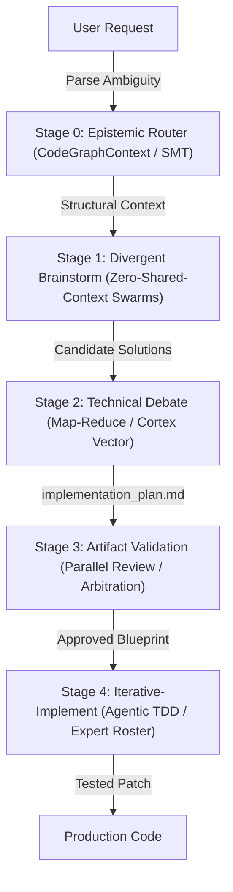
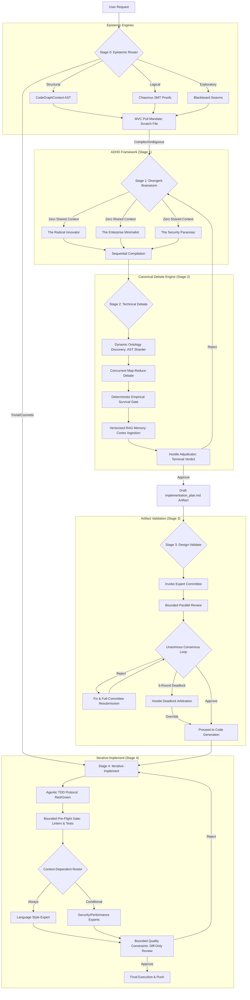

# Antigravity Core

> **The 2026 Agentic Architecture Ecosystem**

This repository contains the globally vetted **Customizations & Governance
Ecosystem** for Google Antigravity and Claude Code. It enforces
enterprise-grade safety, deterministic execution gates, and observability for
autonomous AI coding agents operating on your codebase.

---

## 🏗️ The 2026 Agentic Architecture

By installing this ecosystem, you inject the **Harness-Nexus** orchestration
engine into your environment. This transforms raw LLM execution into a
structured, self-policing loop backed by deterministic `PreToolUse` guards.

### High-Level Execution Flow



### Deep Architectural Dive



### Core Protocols & Deterministic `PreToolUse` Gates

1. **Harness-Nexus Consensus Loop**: Requires domain-specific subagents to
   explicitly validate and approve implementation plans before code is written.
   Uses the Hostile Adjudicator pattern to resolve deadlocks and prevent
   infinite oscillation loops.
2. **Deterministic Lifecycle & Safety Gates (`brc-guard.ps1`)**:
   - `stage0-comprehend-problem-gate`: Blocks creating or editing
     `implementation_plan.md` unless a non-empty `scratch/stage0*` artifact
     exists in the active session directory.
   - `stage3-premature-execution-lock`: Blocks setting `RequestFeedback=true`
     on `implementation_plan.md` unless a non-empty `scratch/stage3*` approval
     artifact exists.
   - `subagent-mvc-prompt-cap`: Rejects `invoke_subagent` calls whose `Prompt`
     exceeds the 200-line Minimal Viable Context (MVC) limit.
   - `schedule-patience-timer-condition`: Rejects one-shot `schedule` timers
     that set `TimerCondition="any"` instead of `"never"` or a sender ID.
   - `generated-output-write-guard`: Blocks direct edits to `/dist/` or
     `/build/` outside `scratch/` or `tmp/`.
   - `git-config-mutation-guard` & `git-no-verify-bypass`: Blocks `git config`
     mutations and any `git --no-verify` or `git commit -n` hook bypasses.
   - `secret-file-access` & `harness-config-self-tampering`: Blocks reading
     `.env`, SSH/cloud credentials, or inline API tokens and protects harness
     configs (`hooks.json`, `brc-guard.ps1`, `settings.json`, `plugin.json`).
3. **Workspace Isolation Protocol**: Forces exploratory coding and structural
   refactoring into branched, ephemeral sandboxes (`Workspace: "branch"`) to
   protect `master` from state contamination.
4. **Agentic Test-Driven Development (TDD)**: Enforces a strict Red/Green
   testing loop (the Bounded Pre-Flight Gate) before agents invoke Stage 4 code
   review subagents.
5. **Blast Radius Containment (BRC)**: Forbids high-risk infrastructure
   mutations without emitting a `<BLAST_RADIUS>` XML assessment and yielding for
   explicit human authorization.
6. **Causal Telemetry**: Logs structured decision traces to
   `agentic_telemetry.md` via `PostToolUse` hooks when critical autonomous
   verdicts occur.

---

## 🛠️ The Ecosystem (19 Skills & Declarative Subagents)

Antigravity executes these protocols via the 19 dynamic skills in
`.agents/skills/` and declarative read-only subagent manifests in
`.agents/agents/` (`stage3-design-reviewer.md`, `stage4-code-auditor.md`):

### Stage Orchestration

- `comprehend-problem`: The Stage 0 Epistemic Router for deterministic problem
  modeling (`chiasmus_poc.py --out`, `blackboard_swarm_poc.py --out`).
- `brainstorm-solutions`: Stage 1 Divergent Brainstorming via
  zero-shared-context swarms (ADHD & ReDNA frameworks).
- `debate` & `technical-debate`: The canonical Level 4 Map-Reduce engines for
  rigorous Stage 2 adversarial vetting and deadlock arbitration.
- `design-validate`: Stage 3 orchestration that validates architecture
  artifacts and `implementation_plan.md` prior to code execution.
- `iterative-implement`: Stage 4 orchestration that triggers the bounded
  pre-flight test gate and expert implementation committee.

### Governance, Security & Linter Experts

- `security-auditor`: Two-pass Hunter-Verifier security auditing rubric for
  Stage 4 code diffs and harness configurations covering CWE and OWASP LLM 2025
  threat classes.
- `markdown-style-expert`: Validates Markdown files and skill heuristics against
  the Google Markdown Style Guide.
- `style-cpp`, `style-go`, `style-java`, `style-js`, `style-python`,
  `style-rust`: Authoritative language-specific style guides, companion
  `-edge-cases.md` references, and mechanical linters.

### Cortex & RAG Integration

- `cortex-librarian`: Read-only specialist querying the local Cortex vector
  database to retrieve cited architectural best practices.
- `skill-evolve`: Universal self-evolution hook that patches systemic edge-case
  failures into companion skill references and Cortex memory.

### Tooling & Reverse Engineering

- `reverse-engineer-anything`: Multi-surface static and runtime reverse
  engineering across native, managed, Electron/JS, mobile, and firmware targets.
- `harness-scaffold`: Bootstraps an unmanaged repository with testing
  infrastructure, pre-commit secret scanning, and Git isolation sandboxing.
- `restart-phone-ui`: Safely restarts the decoupled
  `antigravity-remote-control` Phone UI sidecar server on port `3000`.

---

## 🧩 Decoupled Sidecars

External interfaces (such as the Phone UI) are strictly decoupled into
standalone repositories managed via `.agents/sidecars/sidecar.json`. The
`antigravity-remote-control` server operates on port `3000` and is controlled
across process boundaries via `restart-phone-ui`.

---

## 🚀 Installation Modes

You can deploy `antigravity-core` in three ways depending on your workflow:

### 1. Standalone Antigravity Plugin (`package_plugin.py`)

Build a self-contained plugin bundle containing all rules, skills, declarative
subagents, hooks, and MCP configurations:

```powershell
python .agents/scripts/package_plugin.py --output dist/antigravity-core-plugin
agy plugin install dist/antigravity-core-plugin
```

### 2. Global Machine Config Sync (`sync_global_config.py`)

Synchronize the repository's rules, skills, declarative subagents, and MCP
catalogs into your user-level `~/.gemini/` configuration and verify zero drift:

```powershell
python .agents/scripts/sync_global_config.py --apply
python .agents/scripts/sync_global_config.py --check
```

### 3. Workspace Submodule Mode (`.agents`)

To vendor these protocols into a specific project workspace:

```bash
git submodule add https://github.com/nferrer-dev/antigravity-core.git .agents
```

Antigravity automatically discovers `.agents/AGENTS.md`, `.agents/rules/`,
`.agents/skills/`, `.agents/agents/`, and `.agents/hooks/hooks.json` when
operating in the workspace.
