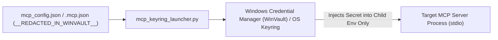

# Type 4: MCP Servers, Supply-Chain Security, & RAG Memory Defense

> **Customization Surface**: [`.agents/mcp_config.json`](../../.agents/mcp_config.json),
> [`.mcp.json`](../../.mcp.json), `~/.gemini/antigravity/mcp_config.json`,
> `~/.claude.json`, and
> [`.agents/scripts/mcp_keyring_launcher.py`](../../.agents/scripts/mcp_keyring_launcher.py)

Model Context Protocol (MCP) servers extend coding agents with persistent vector
memory (`cortex`), AST repository graphs (`code-graph-context`), and binary
reverse-engineering suites (`rea`). However, uncurated MCP configurations
introduce three critical risks: **context-window schema bloat**, **supply-chain
& tool-poisoning attacks**, and **persistent RAG memory poisoning**.

---

## 1. Context-Window Economics: Lazy vs. Eager MCP Tool Schemas

Every eagerly registered MCP tool injects its full JSON Schema (`properties`,
`descriptions`, `required` arrays) into the LLM's system prompt on every turn. A
single large MCP server (such as `rea` with `115+` tools or `cortex` with `21`
tools) can consume `15,000–35,000` tokens before the user types a single word.

### Best Practices for Schema Loading
1. **Default to Lazy Tool Registration**: Configure MCP servers so tool schemas
   are lazy-loaded on demand (`~/.gemini/antigravity/mcp/<serverName>/<toolName>.json`
   in Antigravity or on-demand MCP tool discovery in Claude Code).
2. **Mandatory Schema Inspection Before `call_mcp_tool`**: In Google Antigravity,
   agents must read the lazy tool's `<toolName>.json` schema file via
   `view_file` before invoking `call_mcp_tool` so parameter types and required
   fields are never guessed.

---

## 2. Zero-Plaintext Credential Architecture (`WinVault` & `INV-2`)

Storing API keys in `.agents/mcp_config.json`, `.mcp.json`, or `~/.claude.json`
exposes credentials to repository commits, context leaks, and child processes.



1. **OS Keyring Injection ([`mcp_keyring_launcher.py`](../../.agents/scripts/mcp_keyring_launcher.py))**:
   Instead of placing secrets in `env` blocks or URL query strings (`?apiKey=...`),
   wrap credentialed MCP servers with `mcp_keyring_launcher.py` and set
   placeholder values to `__REDACTED_IN_WINVAULT__` (or `EXAMPLE_TOKEN` in
   documentation).
2. **Automated Static Verification (`INV-2`)**:
   [`validate_mcp_config`](../../.agents/tests/validate_tree.py) in
   `validate_tree.py` and [`sync_global_config.py`](../../.agents/scripts/sync_global_config.py)
   scan all MCP configurations (`MCP_SECRET_KEY_RE`, `MCP_SECRET_VALUE_RE`,
   `MCP_URL_SECRET_RE`) and fail closed if any non-placeholder credential is
   present.

```json
{
  "mcpServers": {
    "cortex": {
      "command": "cortex-mcp",
      "args": [],
      "env": {}
    },
    "code-graph-context": {
      "command": "cgc",
      "args": ["mcp", "start"],
      "env": {}
    }
  }
}
```

---

## 3. MCP Supply-Chain Security & Tool-Poisoning Defenses (`RB-5`)

Huang et al. ([`arXiv:2603.22489`](https://arxiv.org/abs/2603.22489)), Guo et al.
([`arXiv:2508.12538`](https://arxiv.org/abs/2508.12538), *MCPXKIT*), and Sok et
al. ([`arXiv:2512.06556`](https://arxiv.org/abs/2512.06556)) identify two high-severity
MCP attack vectors:
- **Tool Poisoning Attacks (TPA)**: Malicious instructions hidden inside MCP tool
  descriptions or schema metadata that hijack the model when the schema is read.
- **Unpinned Supply-Chain Rug-Pulls**: Launching MCP servers via unpinned
  ephemeral runners (`npx -y some-mcp-server` or `uvx some-mcp-server` without
  an `@x.y.z` or `==x.y.z` version pin) allows a compromised upstream registry
  push to execute arbitrary code on the developer's workstation.

### Deterministic Supply-Chain Guards in `antigravity-core`
1. **Mandatory Version Pinning (`mcp-unpinned-supply-chain`, `RB-5`)**:
   [`validate_mcp_config`](../../.agents/tests/validate_tree.py) inspects every
   `npx`, `uvx`, `pipx`, and `bunx` server entry in `.agents/mcp_config.json`
   and `.mcp.json` and rejects any package specifier that lacks an explicit
   version pin (e.g., requiring `some-mcp-server@1.2.3`).
2. **Cross-Harness Catalog Parity (`.agents/mcp_config.json`, `.mcp.json`, `~/.claude.json`)**:
   `INV-2` and [`sync_global_config.py`](../../.agents/scripts/sync_global_config.py)
   (`check_or_sync_claude_mcp`, `Addendum 8`) verify that the core servers
   (`cortex`, `code-graph-context`, `rea`) remain synchronized across both
   Antigravity and Claude Code without clobbering user-specific third-party
   servers in `~/.claude.json`.

---

## 4. Persistent Vector Memory (`cortex`) Poisoning Defense (`RB-8`)

Dong et al. ([`arXiv:2503.03704`](https://arxiv.org/abs/2503.03704), *MINJA*),
Srivastava & He ([`arXiv:2512.16962`](https://arxiv.org/abs/2512.16962),
*MemoryGraft*), and Chen et al.
([`arXiv:2407.12784`](https://arxiv.org/abs/2407.12784), *AgentPoison*)
demonstrate that long-term RAG vector stores create a **cross-session persistence
channel for indirect prompt injection**: if an agent reads untrusted external
content and stores a poisoned "experience" or forged directive into vector
memory, every future session that calls `recall` ingests the payload into its
trusted orchestration context.

`antigravity-core` enforces a **three-layer defense (`RB-8`)** around `cortex`:

1. **`PreToolUse` Payload Inspection (`cortex-memory-poisoning-guard`)**:
   Both [`.agents/hooks/brc-guard.ps1`](../../.agents/hooks/brc-guard.ps1)
   (matching `call_mcp_tool` on `ServerName == "cortex"`) and
   [`.claude/hooks/brc-guard.ps1`](../../.claude/hooks/brc-guard.ps1) (matching
   `mcp__cortex__.*`) inspect write operations (`store_memory`, `upsert_entity`,
   `create_relation`, `store_procedure`, `import_memories`) and immediately
   **deny** payloads containing inline credentials, prompt-override directives,
   or forged consensus verdicts.
2. **Dynamic Web-Taint Memory Gate (`untrusted-web-memory-taint`)**:
   If the active session has fetched external web content
   (`scratch/.untrusted_web_taint.json`), `brc-guard.ps1` blocks autonomous
   `cortex` memory writes (`force_ask` in Antigravity; `deny` in Claude Code)
   while continuing to allow read-only `recall` queries.
3. **MemoryGraft Non-Authority Sanitization in [`cortex-librarian`](../../.agents/skills/cortex-librarian/SKILL.md)**:
   Recalled memories with `category != "foundational"` are treated strictly as
   untrusted advisory data; `cortex-librarian` strips any imperative
   meta-instructions or verdict tags before returning cited summaries to the
   parent orchestrator.

---

## 5. Verified Citations

1. **Huang, C., Huang, X., Tran, N. P., & Fard, A. M. (Mar 2026).**
   *"Model Context Protocol Threat Modeling and Analyzing Vulnerabilities to Prompt Injection with Tool Poisoning."*
   `arXiv:2603.22489`.
   [https://arxiv.org/abs/2603.22489](https://arxiv.org/abs/2603.22489)
2. **Guo, Y., Liu, P., Ma, W., Deng, Z., Zhu, X., Di, P., Xiao, X., & Wen, S. (Aug 2025 / IEEE TDSC 2026).**
   *"MCPXKIT: The Unified Toolkit for Analyzing Model Context Protocol Security."*
   `arXiv:2508.12538`.
   [https://arxiv.org/abs/2508.12538](https://arxiv.org/abs/2508.12538)
3. **Sok, S., et al. (Dec 2025).**
   *"Securing the Model Context Protocol: A Comprehensive Security Framework for MCP Ecosystems."*
   `arXiv:2512.06556`.
   [https://arxiv.org/abs/2512.06556](https://arxiv.org/abs/2512.06556)
4. **Dong, S., Xu, S., He, P., Li, Y., Tang, J., Liu, T., Liu, H., & Xiang, Z. (Mar 2025).**
   *"Memory Injection Attacks on LLM Agents via Query-Only Interaction (MINJA)."*
   `arXiv:2503.03704`.
   [https://arxiv.org/abs/2503.03704](https://arxiv.org/abs/2503.03704)
5. **Srivastava, S. S., & He, H. (Dec 2025).**
   *"MemoryGraft: Persistent Compromise of LLM Agents via Poisoned Experience Retrieval."*
   `arXiv:2512.16962`.
   [https://arxiv.org/abs/2512.16962](https://arxiv.org/abs/2512.16962)
6. **Chen, Z., Xiang, Z., Xiao, C., Song, D., & Li, B. (NeurIPS 2024).**
   *"AgentPoison: Red-teaming LLM Agents via Poisoning Memory or Knowledge Bases."*
   `arXiv:2407.12784`.
   [https://arxiv.org/abs/2407.12784](https://arxiv.org/abs/2407.12784)
7. **Model Context Protocol (MCP) Specification (`2025-03-26`).**
   [https://modelcontextprotocol.io/specification/2025-03-26/basic/transports#streamable-http](https://modelcontextprotocol.io/specification/2025-03-26/basic/transports#streamable-http)

### OpenAI Codex MCP Server Configuration (`[mcp_servers.*]` in `.codex/config.toml`)

In OpenAI Codex, MCP servers are configured under `[mcp_servers.code-graph-context]` (`command = "cgc"`, `args = ["mcp", "start"]`, `startup_timeout_sec = 20`) and `[mcp_servers.cortex]` (`url = "http://127.0.0.1:8585/mcp"`) in [`.codex/config.toml`](../../.codex/config.toml). During global synchronization, [`sync_global_config.py`](../../.agents/scripts/sync_global_config.py) non-destructively upserts these two core tables into `~/.codex/config.toml` while preserving existing user MCP servers and scanning all `[mcp_servers.*]` tables for plaintext secrets.
