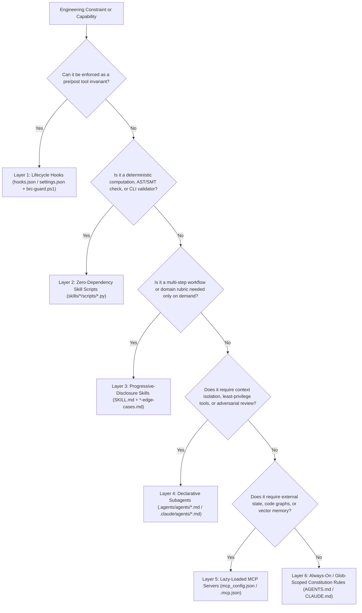

# AI Agent Customization Best-Practices Suite

> **Evidence-Backed Engineering Reference for Google Antigravity (`.agents/`) &
> Claude Code (`CLAUDE.md` / `.claude/`)**

This documentation suite synthesizes **30+ peer-reviewed research papers
(2024–2026)**, official platform specifications, and the production governance
architecture implemented in [`antigravity-core`](../../README.md) across all
**7 AI Coding Agent Customization Surfaces**.

---

## 1. The Deterministic-to-Probabilistic Routing Hierarchy

The foundational engineering principle of `antigravity-core` is **never entrusting
a deterministic invariant to a probabilistic prompt when a lower-layer runtime
mechanism can enforce it mechanically**. Before authoring a customization,
select the lowest layer in the routing hierarchy capable of expressing the
constraint:

| Layer | Customization Surface | Execution Nature | Token Cost When Idle | Primary Use Case |
| :--- | :--- | :--- | :--- | :--- |
| **1** | **Lifecycle Hooks** ([Guide 03](./03-lifecycle-hooks-and-deterministic-guards.md)) | 100% Deterministic (`PreToolUse`, `Stop`) | `0` tokens | Blocking secret reads, SSRF, taint exfiltration, missing Stage 0/3 receipts, and hash-chaining audit telemetry. |
| **2** | **Skill Scripts** ([Guide 02](./02-skills-and-progressive-disclosure.md)) | 100% Deterministic (`python` CLI / AST / SMT) | `0` tokens | Z3/SMT finite-domain verification (`unsat_core`, vacuity), AST call-graph & surface-area diffing, secret scanning. |
| **3** | **Skills & Quarantine** ([Guide 02](./02-skills-and-progressive-disclosure.md)) | On-Demand Progressive Disclosure | `~35` tokens/skill (catalog) | Multi-stage workflows (`comprehend-problem`, `debate`) and lazy-loaded language/security style rubrics. |
| **4** | **Subagents** ([Guide 05](./05-subagents-and-consensus-orchestration.md)) | Isolated Context + Tool Sandboxing | `0` tokens in parent | Read-only Stage 3/4 review committees (`commandExecutionPolicy: off`) and `Workspace: "branch"` / `worktree` coding. |
| **5** | **MCP Servers** ([Guide 04](./04-mcp-servers-and-supply-chain-security.md)) | External Process / RPC (`stdio` / HTTP) | `0` tokens when lazy-loaded | Persistent vector RAG (`cortex`), AST repository graphs (`code-graph-context`), and binary decompilation (`rea`). |
| **6** | **Rules & Instructions** ([Guide 01](./01-rules-and-instructions.md)) | Probabilistic Prompt Conditioning | Always-on (or glob-scoped) | High-level routing matrix, epistemic humility, and global architectural invariants (`<18 KB` per file). |
| **7** | **Plugins & Sidecars** ([Guide 06](./06-plugins-and-packaging.md), [Guide 07](./07-sidecars-automations-and-generative-ui.md)) | Packaging, Global Sync, & Aux Processes | `0` tokens | Cryptographically attested distribution (`integrity_manifest.json`), dual-harness global sync, cron jobs, and `<agent-embed>` UI. |

---

## 2. Dual-Harness Architecture Comparison Matrix

`antigravity-core` maintains a strict **Dual-Tree Isolation Architecture**
(`INV-8`) so both Google Antigravity and Claude Code operate natively at 100%
capability from the same repository and global machine sync
([`sync_global_config.py`](../../.agents/scripts/sync_global_config.py)):

| Dimension | Google Antigravity (`.agents/`) | Claude Code (`CLAUDE.md` & `.claude/`) | Shared Governance Invariant |
| :--- | :--- | :--- | :--- |
| **Root Constitution** | [`.agents/AGENTS.md`](../../.agents/AGENTS.md) (`<18,000` bytes; hard platform cap `24,000` bytes; no YAML frontmatter) | [`CLAUDE.md`](../../CLAUDE.md) (`<150` lines; conciseness-optimized root routing table) | `INV-4`, `INV-6`, `INV-8` |
| **Modular Rules** | [`.agents/rules/*.md`](../../.agents/rules/) (`trigger: always_on \| glob \| model_decision \| manual`) | [`.claude/rules/*.md`](../../.claude/rules/) (optional `paths:` glob frontmatter) | Flat directory structure (`INV-4`); UTF-8 LF no BOM (`INV-6`). |
| **Skills & Scripts** | [`.agents/skills/<name>/SKILL.md`](../../.agents/skills/) (`disable-slash-command: true` for internal rubrics) | [`.claude/skills/<name>/SKILL.md`](../../.claude/skills/) (`user-invocable: false` for internal rubrics) | 19-skill parity, `[skillname]-edge-cases.md` quarantine (`INV-7`), zero-dep `scripts/`. |
| **Lifecycle Hooks** | [`.agents/hooks.json`](../../.agents/hooks.json) -> [`.agents/hooks/brc-guard.ps1`](../../.agents/hooks/brc-guard.ps1) & [`telemetry-append.ps1`](../../.agents/hooks/telemetry-append.ps1) | [`.claude/settings.json`](../../.claude/settings.json) -> [`.claude/hooks/brc-guard.ps1`](../../.claude/hooks/brc-guard.ps1) & [`telemetry-append.ps1`](../../.claude/hooks/telemetry-append.ps1) | 7-bit ASCII `.ps1` (`INV-5`), identical rule-ID contract (`INV-3`, `RB-21`), `[chain:<8hex>]` SHA-256 telemetry (`RB-11`, `RB-19`). |
| **Declarative Subagents** | [`.agents/agents/*.md`](../../.agents/agents/) (`commandExecutionPolicy: off`) + `invoke_subagent` | [`.claude/agents/*.md`](../../.claude/agents/) (`tools: Read, Grep, Glob`, `disallowedTools: Edit, Write`, `isolation: worktree`) | Least-privilege read-only auditors (`RB-9`) and sandboxed implementers. |
| **MCP Catalog** | [`.agents/mcp_config.json`](../../.agents/mcp_config.json) & `~/.gemini/antigravity/mcp_config.json` | [`.mcp.json`](../../.mcp.json) & `~/.claude.json` (`mcpServers`) | Zero inline secrets (`INV-2`), OS keyring launcher, version pinning (`RB-5`), Cortex taint guard (`RB-8`). |
| **Packaging & Sync** | [`package_plugin.py`](../../.agents/scripts/package_plugin.py) (`plugin.json` + `integrity_manifest.json`) & `sync_global_config.py` (`~/.gemini`) | [`sync_global_config.py`](../../.agents/scripts/sync_global_config.py) (`~/.claude` junctions + `settings.json` hook upserts + `~/.claude.json`) | Double-load prevention (`"disabled": true` in repo `plugin.json`, `INV-2`) and idempotent NTFS junctions (`INV-9`). |

---

## 3. Best-Practices Guide Index

1. [**01 — Rules & Hierarchical Instructions**](./01-rules-and-instructions.md)
    - Context-window physics (`24,000`-byte hard truncation cap, `IFScale`
      instruction density decay, serial-position U-curve), eliminating
      directory-tree bloat (`arXiv:2602.11988`), and modular rule activation.
2. [**02 — Skills, Progressive Disclosure, & Self-Evolution**](./02-skills-and-progressive-disclosure.md)
    - 3-tier progressive disclosure, negative trigger boundaries in
      `description`, deterministic Python `scripts/` (`logical_z3_polyfill.py`,
      `structural_graph_polyfill.py`), and `ACE Curator` edge-case quarantine
      (`*-edge-cases.md`).
3. [**03 — Lifecycle Hooks, Runtime Guards, & Information-Flow Control**](./03-lifecycle-hooks-and-deterministic-guards.md)
    - `CaMeL` control/data separation, `Fides` dynamic web-taint tracking
      (`.untrusted_web_taint.json`), `.NET` canonical URI/IP SSRF parsing, shell
      quote-splitting de-obfuscation, and SHA-256 hash-chained audit logs.
4. [**04 — MCP Servers, Supply-Chain Security, & RAG Memory Defense**](./04-mcp-servers-and-supply-chain-security.md)
    - Lazy vs. eager schema economics, OS Keyring (`WinVault`) credential
      isolation, `npx`/`uvx` supply-chain pinning, Tool Poisoning (`TPA`)
      mitigation, and `MINJA`/`MemoryGraft` vector-memory defenses.
5. [**05 — Subagents, Consensus Orchestration, & Anti-Sycophancy**](./05-subagents-and-consensus-orchestration.md)
    - Declarative read-only subagents, `SEAgent`/`MiniScope` Mandatory Access
      Control, Stage 1 zero-shared-context swarms, Stage 2 SHA-256 canonical
      claim ordering, Vote-Tally Blindness, `VeriHarness` rejection evidence,
      and `Meta ACH` test-oracle integrity.
6. [**06 — Distributable Plugins, Cryptographic BOMs, & Global Sync**](./06-plugins-and-packaging.md)
    - Antigravity's 8-key `ALLOWED_PLUGIN_FIELDS` v1 schema (`INV-2`),
      double-load prevention (`"disabled": true`), SHA-256
      `integrity_manifest.json` (`RB-14`), and non-destructive dual-harness
      global machine sync (`Addendum 8`).
7. [**07 — Sidecars, Scheduled Automations, & Generative UI**](./07-sidecars-automations-and-generative-ui.md)
    - Decoupled `sidecar.json` process management, `CRON_TZ` scheduled
      automations with least-privilege `access_grants`, `TimerCondition="never"`
      patience timers, and `<agent-embed>` / WCAG 2.1 AA Generative UI rules.

---

## 4. Master Verified Bibliography

### Context Engineering, Rules, & Progressive Disclosure

1. **Gloaguen, T., Mündler-Sasahara, N., Müller, M. N., Raychev, V., & Vechev, M. (Feb 2026).**
   *"Evaluating AGENTS.md: Are Repository-Level Context Files Helpful for Coding Agents?"*
   ETH Zurich & LogicStar.ai, `arXiv:2602.11988`.
   [https://arxiv.org/abs/2602.11988](https://arxiv.org/abs/2602.11988)
2. **Lulla, J. L., Mohsenimofidi, S., Galster, M., Zhang, J. M., Baltes, S., & Treude, C. (Jan 2026).**
   *"On the Impact of AGENTS.md Files on the Efficiency of AI Coding Agents."*
   `arXiv:2601.20404`.
   [https://arxiv.org/abs/2601.20404](https://arxiv.org/abs/2601.20404)
3. **Liu, N. F., Lin, K., Hewitt, J., Paranjape, A., Bevilacqua, M., Petroni, F., & Liang, P. (2024).**
   *"Lost in the Middle: How Language Models Use Long Contexts."*
   *Transactions of the Association for Computational Linguistics (TACL)*, `arXiv:2307.03172`.
   [https://arxiv.org/abs/2307.03172](https://arxiv.org/abs/2307.03172)
4. **Guo, X., & Vosoughi, S. (Jun 2024).**
   *"Serial Position Effects of Large Language Models."*
   `arXiv:2406.15981`.
   [https://arxiv.org/abs/2406.15981](https://arxiv.org/abs/2406.15981)
5. **Jaroslawicz, D., et al. (Jul 2025).**
   *"How Many Instructions Can LLMs Follow at Once? (IFScale)."*
   `arXiv:2507.11538`.
   [https://arxiv.org/abs/2507.11538](https://arxiv.org/abs/2507.11538)
6. **Xiao, Y., et al. (Sep 2025).**
   *"Improving the Efficiency of LLM Agent Systems through Trajectory Reduction (AgentDiet)."*
   `arXiv:2509.23586`.
   [https://arxiv.org/abs/2509.23586](https://arxiv.org/abs/2509.23586)

### Skills, Code Graphs, Formal Verification, & Self-Evolving Quarantine

7. **Wang, G., Xie, Y., Jiang, Y., Mandlekar, A., Xiao, C., Zhu, Y., Fan, L., & Anandkumar, A. (2023/2024).**
   *"Voyager: An Open-Ended Embodied Agent with Large Language Models."*
   NVIDIA & Caltech, `arXiv:2305.16291`.
   [https://arxiv.org/abs/2305.16291](https://arxiv.org/abs/2305.16291)
8. **Zhang, Q., Hu, C., Upasani, S., Ma, B., Hong, F., Kamanuru, V., Rainton, J., Wu, C., Ji, M., Li, H., Thakker, U., Zou, J., & Olukotun, K. (Oct 2025).**
   *"Agentic Context Engineering: Evolving Contexts for Self-Improving Language Models (ACE)."*
   Stanford University & SambaNova Systems, `arXiv:2510.04618`.
   [https://arxiv.org/abs/2510.04618](https://arxiv.org/abs/2510.04618)
9. **Zhang, Z., et al. (Feb 2026).**
   *"Formal Specification-Driven Coding Agents with Automated Solver Verification."*
   `arXiv:2602.08146`.
   [https://arxiv.org/abs/2602.08146](https://arxiv.org/abs/2602.08146)
10. **Ouyang, S., Yu, W., Ma, K., Xiao, Z., Zhang, Z., Jia, M., Han, J., Zhang, H., & Yu, D. (ICLR 2025).**
    *"RepoGraph: Enhancing AI Software Engineering with Repository-level Code Graph."*
    `arXiv:2410.14684`.
    [https://arxiv.org/abs/2410.14684](https://arxiv.org/abs/2410.14684)
11. **Chen, Z., Tang, X., Deng, G., Wu, F., Wu, J., Jiang, Z., Prasanna, V., Cohan, A., & Wang, X. (ACL 2025).**
    *"LocAgent: Graph-Guided LLM Agents for Code Localization."*
    `arXiv:2503.09089`.
    [https://arxiv.org/abs/2503.09089](https://arxiv.org/abs/2503.09089)
12. **Wang, Y., Pradel, M., & Liu, Z. (Mar 2025).**
    *"Are 'Solved Issues' in SWE-bench Really Solved Correctly? An Empirical Study (PatchDiff)."*
    `arXiv:2503.15223`.
    [https://arxiv.org/abs/2503.15223](https://arxiv.org/abs/2503.15223)

### Runtime Security, Information-Flow Control, MCP, & Provenance

13. **Debenedetti, E., Zhang, J., Balunović, M., Beurer-Kellner, L., Fischer, M., & Tramèr, F. (Jun 2024 / 2025).**
    *"AgentDojo: A Dynamic Environment to Evaluate Prompt Injection Attacks and Defenses for LLM Agents."*
    ETH Zurich, `arXiv:2406.13352`.
    [https://arxiv.org/abs/2406.13352](https://arxiv.org/abs/2406.13352)
14. **Debenedetti, E., Shumailov, I., Fan, T., Soares, J., & Tramèr, F. (Mar 2025).**
    *"Defending LLM Agents Against Prompt Injection with CaMeL."*
    Google DeepMind & ETH Zurich, `arXiv:2503.18813`.
    [https://arxiv.org/abs/2503.18813](https://arxiv.org/abs/2503.18813)
15. **Costa, M., Fournet, C., Köpf, B., Paverd, A., Russinovich, M., & Zanella-Béguelin, S. (May 2025).**
    *"Securing AI Agents with Information-Flow Control (Fides)."*
    Microsoft Research, `arXiv:2505.23643`.
    [https://arxiv.org/abs/2505.23643](https://arxiv.org/abs/2505.23643)
16. **Tekgul, B., et al. (Apr 2026).**
    *"Practical Integrity Validation for Dynamic Information Flow Control in LLM Agents (NeuroTaint)."*
    `arXiv:2604.23374`.
    [https://arxiv.org/abs/2604.23374](https://arxiv.org/abs/2604.23374)
17. **Wang, P., Liu, Y., Lu, Y., Cai, Y., Chen, H., Yang, Q., Zhang, J., Hong, J., & Wu, Y. (Aug 2025).**
    *"AgentArmor: Enforcing Program Analysis on Agent Runtime Trace to Defend Against Prompt Injection."*
    ByteDance, `arXiv:2508.01249`.
    [https://arxiv.org/abs/2508.01249](https://arxiv.org/abs/2508.01249)
18. **Huang, C., Huang, X., Tran, N. P., & Fard, A. M. (Mar 2026).**
    *"Model Context Protocol Threat Modeling and Analyzing Vulnerabilities to Prompt Injection with Tool Poisoning."*
    `arXiv:2603.22489`.
    [https://arxiv.org/abs/2603.22489](https://arxiv.org/abs/2603.22489)
19. **Guo, Y., Liu, P., Ma, W., Deng, Z., Zhu, X., Di, P., Xiao, X., & Wen, S. (Aug 2025 / IEEE TDSC 2026).**
    *"MCPXKIT: The Unified Toolkit for Analyzing Model Context Protocol Security."*
    `arXiv:2508.12538`.
    [https://arxiv.org/abs/2508.12538](https://arxiv.org/abs/2508.12538)
20. **Sok, S., et al. (Dec 2025).**
    *"Securing the Model Context Protocol: A Comprehensive Security Framework for MCP Ecosystems."*
    `arXiv:2512.06556`.
    [https://arxiv.org/abs/2512.06556](https://arxiv.org/abs/2512.06556)
21. **Dong, S., Xu, S., He, P., Li, Y., Tang, J., Liu, T., Liu, H., & Xiang, Z. (Mar 2025).**
    *"Memory Injection Attacks on LLM Agents via Query-Only Interaction (MINJA)."*
    `arXiv:2503.03704`.
    [https://arxiv.org/abs/2503.03704](https://arxiv.org/abs/2503.03704)
22. **Srivastava, S. S., & He, H. (Dec 2025).**
    *"MemoryGraft: Persistent Compromise of LLM Agents via Poisoned Experience Retrieval."*
    `arXiv:2512.16962`.
    [https://arxiv.org/abs/2512.16962](https://arxiv.org/abs/2512.16962)
23. **Chen, Z., Xiang, Z., Xiao, C., Song, D., & Li, B. (NeurIPS 2024).**
    *"AgentPoison: Red-teaming LLM Agents via Poisoning Memory or Knowledge Bases."*
    `arXiv:2407.12784`.
    [https://arxiv.org/abs/2407.12784](https://arxiv.org/abs/2407.12784)
24. **Wang, Y., et al. (Jun 2026).**
    *"From Agent Traces to Trust: A Survey of Evidence Tracing and Execution Provenance in LLM Agents."*
    `arXiv:2606.04990`.
    [https://arxiv.org/abs/2606.04990](https://arxiv.org/abs/2606.04990)

### Multi-Agent Consensus, Access Control, & Verification

25. **Cemri, M., Pan, M. Z., Yang, S., Agrawal, L. A., Chopra, B., Tiwari, R., Keutzer, K., Parameswaran, A., Klein, D., Ramchandran, K., Zaharia, M., Gonzalez, J. E., & Stoica, I. (Mar 2025).**
    *"Why Do Multi-Agent LLM Systems Fail? (MAST)."*
    UC Berkeley, `arXiv:2503.13657`.
    [https://arxiv.org/abs/2503.13657](https://arxiv.org/abs/2503.13657)
26. **Liang, T., He, Z., Jiao, W., Wang, X., Wang, Y., Wang, R., Yang, Y., Shi, S., & Tu, Z. (EMNLP 2024).**
    *"Encouraging Divergent Thinking in Large Language Models through Multi-Agent Debate."*
    `arXiv:2305.19118`.
    [https://arxiv.org/abs/2305.19118](https://arxiv.org/abs/2305.19118)
27. **Du, Y., Li, S., Torralba, A., Tenenbaum, J. B., & Mordatch, I. (ICML 2024).**
    *"Improving Factuality and Reasoning in Language Models through Multiagent Debate."*
    `arXiv:2305.14325`.
    [https://arxiv.org/abs/2305.14325](https://arxiv.org/abs/2305.14325)
28. **Choi, H. K., Xu, W., & Xue, S. (Oct 2025).**
    *"Debate or Vote: Which Yields Better Decisions in Multi-Agent Large Language Models?"*
    `arXiv:2510.07517`.
    [https://arxiv.org/abs/2510.07517](https://arxiv.org/abs/2510.07517)
29. **Wynn, A., Satija, H., & Hadfield-Menell, D. (Sep 2025).**
    *"Talk Isn't Always Cheap: Understanding Failure Modes in Multi-Agent Debate."*
    `arXiv:2509.23055`.
    [https://arxiv.org/abs/2509.23055](https://arxiv.org/abs/2509.23055)
30. **Ma, C., Zhang, E., Zhao, Y., Liu, W., Jia, Y., Qing, P., Shi, L., Cohan, A., Yan, Y., & Vosoughi, S. (May 2025).**
    *"Judging with Many Minds: Do More Perspectives Mean Less Prejudice? On Bias Amplifications and Resistance in Multi-Agent Based LLM-as-Judge."*
    `arXiv:2505.19477`.
    [https://arxiv.org/abs/2505.19477](https://arxiv.org/abs/2505.19477)
31. **Shi, L., Ma, C., Liang, W., Diao, X., Ma, W., & Vosoughi, S. (Jun 2024 / 2025).**
    *"Judging the Judges: A Systematic Study of Position Bias in LLM-as-a-Judge."*
    `arXiv:2406.07791`.
    [https://arxiv.org/abs/2406.07791](https://arxiv.org/abs/2406.07791)
32. **Jin, H., et al. (Feb 2026).**
    *"VeriHarness: Execution-Grounded Verification for Autonomous Coding Agents."*
    `arXiv:2602.09420`.
    [https://arxiv.org/abs/2602.09420](https://arxiv.org/abs/2602.09420)
33. **Ji, Z., et al. (Jan 2026).**
    *"Taming Various Privilege Escalation in LLM-Based Agent Systems: A Mandatory Access Control Framework (SEAgent)."*
    `arXiv:2601.11893`.
    [https://arxiv.org/abs/2601.11893](https://arxiv.org/abs/2601.11893)
34. **Zhu, J., Tseng, K., Vernik, G., Huang, X., Patil, S. G., Fang, V., & Popa, R. A. (Dec 2025).**
    *"MiniScope: Authorizing Agents with Least-Privilege Permissions."*
    UC Berkeley & IBM Research, `arXiv:2512.11147`.
    [https://arxiv.org/abs/2512.11147](https://arxiv.org/abs/2512.11147)
35. **Foster, C., Gulati, A., Harman, M., Harper, I., Mao, K., Ritchey, J., Robert, H., & Sengupta, S. (Jan 2025).**
    *"Mutation-Guided LLM-based Test Generation at Meta (ACH)."*
    Meta Platforms, `arXiv:2501.12862`.
    [https://arxiv.org/abs/2501.12862](https://arxiv.org/abs/2501.12862)
36. **Atinafu, Y., & Cohen, R. (Mar 2026).**
    *"RewardHackingAgents: Empirical Analysis of Specification Gaming in Coding Agents."*
    `arXiv:2603.11337`.
    [https://arxiv.org/abs/2603.11337](https://arxiv.org/abs/2603.11337)

### OpenAI Codex (`CODEX.md` & `.codex/`) Tri-Harness Parity

Alongside Google Antigravity (`.agents/`) and Claude Code (`CLAUDE.md` / `.claude/`), `antigravity-core` provides full autonomous session parity for **OpenAI Codex (`codex-cli 0.115.0` and the Codex Desktop App)** via root [`CODEX.md`](../../CODEX.md) and [`.codex/`](../../.codex/config.toml), synchronized globally to `~/.codex/` by [`sync_global_config.py`](../../.agents/scripts/sync_global_config.py) and validated across `INV-1`–`INV-10` by [`.codex/tests/validate_tree.py`](../../.codex/tests/validate_tree.py).
